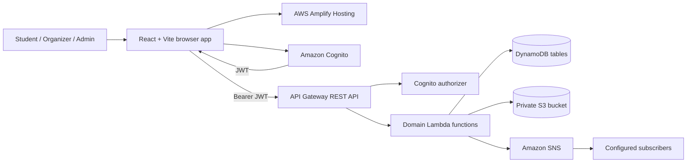

# CampusConnect

CampusConnect is a full-stack university community hub for events, student societies, workshops, opportunities, announcements, and role-specific campus operations.

The repository contains a complete local demonstration mode and an AWS deployment layer. Local mode works without cloud credentials and persists changes in the browser. The AWS CDK stack compiles and synthesizes, but it has **not** been deployed or exercised against a real AWS account from this workspace.

## What is included

### Student experience

- Student sign-up and sign-in
- Personalized dashboard and recommendations
- Event search, category filters, popularity/date sorting, and detail pages
- Capacity-aware event registration and cancellation
- Community discovery, member/leader views, joining, and leaving
- Announcement feed and category filtering
- Editable profile, interests, skills, and validated local profile-image upload
- Registered-event and joined-community views

### Organizer experience

- Recharts registration trends and event participation analytics
- Event creation, draft/publish state, editing, and capacity validation
- Participant directory, attendance management, and CSV export
- Community-scoped announcement publishing

### Administrator experience

- Platform-wide Recharts analytics
- User search, filtering, suspension, and reactivation
- Society application approval and rejection
- Event and announcement moderation
- Campus-wide announcement publishing

### User experience

- Responsive public navigation and dashboard shell
- Loading, empty, success, and error states
- Accessible labels, focus states, reduced-motion handling, and keyboard-friendly controls
- Persistent mock data with one-click reset
- No inert primary actions

## Technology

- React 18, TypeScript, Vite
- Tailwind CSS and local shadcn-style UI primitives
- React Router
- Lucide icons
- Recharts
- AWS Amplify client library
- AWS CDK v2
- Amazon Cognito, API Gateway, Lambda, DynamoDB, S3, and SNS

## Run locally

### Prerequisites

- Node.js 20 or later. Node.js 22 is recommended for the infrastructure toolchain.
- npm 10 or later

### Start the application

```bash
npm install
cp .env.example .env.local
npm run dev
```

Open `http://localhost:5173`.

`VITE_DATA_MODE` defaults to `mock`, so copying the environment file is optional for local use.

### Demo accounts

All seeded demo accounts use password `demo123`.

| Role | Email | Destination |
|---|---|---|
| Student | `aisha.khan@campus.edu` | Student dashboard |
| Organizer | `cloudclub@campus.edu` | Organizer analytics |
| Administrator | `admin@campus.edu` | Administration dashboard |

The seed contains 20 student profiles, three organizer profiles, one administrator, six approved showcase communities, two pending society applications, ten upcoming events, eight announcements, memberships, and event registrations. Event dates are generated relative to the day the browser initializes the seed.

### Reset demonstration data

Use **Reset demo data** at the bottom of any signed-in dashboard sidebar. This replaces local changes with a new copy of the seed.

The mock database uses these browser storage keys:

- `campusconnect:demo-db:v1`
- `campusconnect:session:v1`

Local registration passwords are stored as SHA-256 digests for demo convenience. This browser-only design is not a substitute for a production identity provider. AWS mode delegates credentials to Cognito.

## Scripts

| Command | Purpose |
|---|---|
| `npm run dev` | Start Vite development mode |
| `npm run build` | Type-check and create a production bundle |
| `npm run lint` | Run frontend lint checks |
| `npm run preview` | Preview the built frontend locally |
| `npm run infra:build` | Type-check CDK and Lambda code |
| `npm run infra:synth` | Synthesize the CloudFormation template |

## Environment variables

| Variable | Local default | Description |
|---|---|---|
| `VITE_DATA_MODE` | `mock` | Use `mock` or `aws` services |
| `VITE_AWS_REGION` | empty | Region containing Cognito and the API |
| `VITE_COGNITO_USER_POOL_ID` | empty | Cognito User Pool ID |
| `VITE_COGNITO_USER_POOL_CLIENT_ID` | empty | Browser app client ID |
| `VITE_API_BASE_URL` | empty | API Gateway stage URL without a trailing slash |
| `VITE_UPLOAD_BUCKET_NAME` | empty | S3 media bucket name |

Never place AWS access keys, client secrets, or other credentials in a `VITE_` variable. Vite embeds those values in browser JavaScript.

## Architecture



See [docs/architecture.md](docs/architecture.md) for trust boundaries, request flows, and deployment notes. See [docs/database-schema.md](docs/database-schema.md) for keys, indexes, and access patterns.

## Project structure

```text
src/
  components/       shared UI, cards, navigation, route protection
  config/           typed environment configuration
  context/          authentication, application data, and toast state
  data/             clearly labeled local demonstration seed
  layouts/          public and role-dashboard shells
  lib/              formatting and shared utilities
  pages/            public, student, organizer, and admin routes
  services/         mock and AWS service adapters
  types/            domain and service contracts
infrastructure/
  bin/               CDK application entry
  lib/               resource stack
  lambda/            authorized domain handlers and shared utilities
docs/                architecture, data model, and implementation plan
```

## AWS deployment

### Current verification status

- Frontend TypeScript and Vite production build: verified locally
- Frontend ESLint: verified locally
- Infrastructure/Lambda TypeScript: verified locally
- CDK synthesis: verified locally
- AWS account deployment: **not performed**
- Live Cognito, API, S3, SNS, and Amplify behavior: **not tested**

### Prerequisites

1. Configure an authorized AWS CLI profile.
2. Choose an AWS Region.
3. Install project and infrastructure dependencies.
4. Bootstrap CDK in the target account and Region.

```bash
npm install
npm --prefix infrastructure install
npx --prefix infrastructure cdk bootstrap aws://ACCOUNT_ID/REGION
```

### Inspect and deploy

```bash
npm run infra:build
npm run infra:synth
npm --prefix infrastructure run diff -- -c allowedOrigin=http://localhost:5173 -c retainData=true
npm --prefix infrastructure run deploy -- -c allowedOrigin=http://localhost:5173 -c retainData=true
```

`retainData=true` is the safe default. DynamoDB tables and the S3 bucket use retention policies and table deletion protection. A disposable development environment can explicitly use `-c retainData=false`.

The stack outputs the API URL, User Pool ID, app client ID, upload bucket, SNS topic, and Amplify App ID. The Amplify app is deliberately created without repository credentials. Connect a repository or use Amplify manual deployment, then redeploy with the real Amplify origin:

```bash
npm --prefix infrastructure run deploy -- -c allowedOrigin=https://YOUR_BRANCH.YOUR_APP_ID.amplifyapp.com -c retainData=true
```

Configure SNS subscriptions only for approved destinations. Populate production DynamoDB tables through a controlled migration or administration process; the browser mock seed is never uploaded automatically.

### Initial roles

Cognito post-confirmation assigns new accounts to the `student` group and writes a student profile. Promote organizers or administrators through an authorized operations process that updates both the Cognito group and the DynamoDB `role` field. Do not expose role selection during public sign-up.

### Amplify build settings

The CDK app includes this build flow:

```text
npm ci
npm run build
publish dist/**
```

Generated Amplify environment variables select the AWS adapter and point it at the deployed resources.

## Data and concurrency

Event registration uses `TransactWriteItems`:

1. Conditionally create `(eventId, userId)` so a duplicate cannot exist.
2. Increment the event counter only when `registrationCount < capacity` and the event is published.
3. Write a user notification in the same transaction.

Cancellation conditionally deletes the registration and decrements the counter in one transaction. Community membership uses the same conditional transaction pattern.

## Security notes

- API Gateway validates Cognito JWTs on protected routes.
- Lambda repeats role and ownership checks before mutations.
- Students cannot choose organizer/admin roles during registration.
- Browser validation improves feedback; Lambda Zod schemas validate the trust boundary again.
- S3 blocks public access, enforces TLS, encrypts objects, versions files, and issues five-minute presigned POST policies with MIME and size constraints.
- DynamoDB tables use encryption, point-in-time recovery, and safe retention defaults.
- IAM grants domain functions access only to their required resources.
- Error responses omit stack traces, tokens, and profile payloads.
- The production bootstrap response removes private account fields from unrelated profiles.

Before a real launch, add institutional privacy review, CloudTrail/CloudWatch alarms, API abuse controls or WAF, backup restore exercises, verified sender configuration, data-retention policies, and end-to-end tests in a non-production AWS account.

## Documentation

- [Implementation plan](docs/implementation-plan.md)
- [AWS architecture](docs/architecture.md)
- [DynamoDB schema](docs/database-schema.md)
- [Infrastructure notes](infrastructure/README.md)

## Known production follow-ups

The local MVP is demonstration-ready. A production rollout still needs a real AWS deployment, repository connection in Amplify, DNS/domain decisions, seeded production content, organizer/admin provisioning, Cognito confirmation UX validation, notification subscription policy, observability alarms, and institution-specific privacy/accessibility review.
