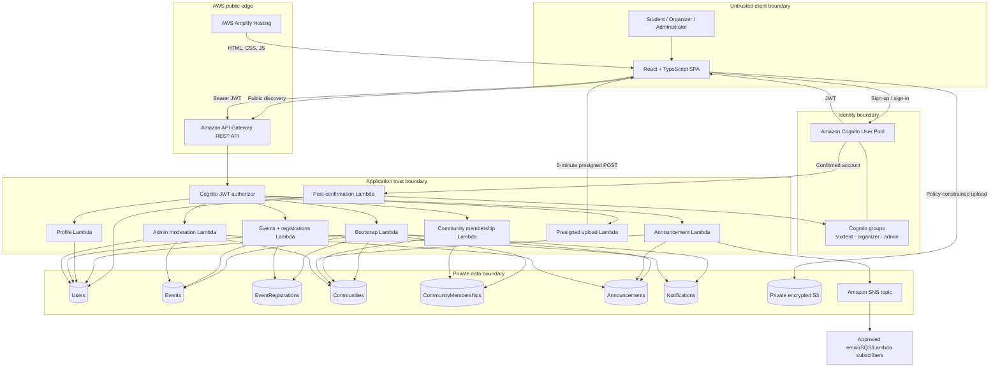

# CampusConnect architecture

## System context

CampusConnect uses a local-first service contract. React pages call `AuthService` and `CampusService`; environment configuration selects either browser mock implementations or AWS implementations. Pages do not import DynamoDB, Cognito, or mock storage directly.

## AWS architecture diagram

## Request flows

### Public discovery

1. Amplify serves the static Vite bundle.
2. A visitor calls `GET /public/bootstrap` without a token.
3. API Gateway invokes the bootstrap Lambda.
4. The Lambda returns only published events and announcements plus approved communities. It returns no users, memberships, registrations, or notifications.

### Authenticated request

1. Cognito authenticates the user and issues short-lived tokens.
2. The browser sends the access token in `Authorization: Bearer …`.
3. API Gateway's Cognito authorizer validates issuer, audience, signature, and expiry.
4. Lambda reads `sub` and `cognito:groups`, verifies the account remains active in DynamoDB, and applies operation-specific role and ownership rules.
5. IAM limits each Lambda to the tables or services its domain needs.

### Event registration

1. The event Lambda requires the `student` group.
2. It reads the event and confirms it is published and has not started.
3. One DynamoDB transaction conditionally creates the registration, conditionally increments the counter below capacity, and creates a notification.
4. Concurrent attempts cannot create a duplicate or push the event past capacity.

### Safe media upload

1. An authenticated user requests an upload policy with purpose, MIME type, name, and size.
2. Lambda accepts JPG, PNG, WebP, or PDF up to 5 MB and generates a server-owned key under the user's prefix.
3. The browser posts directly to private S3 using a five-minute policy.
4. S3 enforces the content type and content-length range. Public ACLs are blocked.

### Announcement notification

1. Organizer/admin authorization and scope checks run before the write.
2. Lambda writes the announcement.
3. Published announcements emit a small event envelope to SNS.
4. Deployers attach only approved subscriptions. Message delivery is separate from the request path.

## Resource ownership

| Function | Read | Write |
|---|---|---|
| Bootstrap | All domain tables | None |
| Profile | Current user | Current user profile fields |
| Events | Users, communities, events, registrations | Events, registrations, notifications |
| Communities | Users, communities, memberships | Memberships, member counters |
| Announcements | Users, communities | Announcements, SNS publish |
| Admin | Users, communities, events, announcements | Moderation/status fields |
| Uploads | None | S3 keys under generated prefixes |
| Post-confirmation | Cognito event | User profile, student group membership |

## Availability and scale

- Lambda and API Gateway scale without server management.
- DynamoDB uses on-demand billing and query-oriented GSIs.
- S3 carries upload bandwidth directly rather than proxying files through Lambda.
- Registration counters use transactions for correctness under concurrency.
- The initial bootstrap endpoint uses scans for a compact campus MVP. Before datasets approach DynamoDB's 1 MB scan page, replace it with paginated domain queries and cached public feeds.
- CloudFront is managed by Amplify Hosting for static delivery.

## Deployment boundaries

The CDK stack creates an Amplify app and branch but does not store source-provider credentials. Repository connection is a deployment-owner action. The allowed web origin is a CDK context value so API and S3 CORS do not default to arbitrary origins.

The stack synthesized successfully in the local workspace. No live AWS resources were created or tested.
